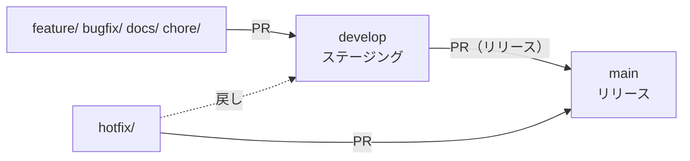

# [App Name] Application Repository

<!-- 1〜3行でアプリケーションの概要を書く -->

## ⚡ QuickStart

```bash
git clone https://github.com/tinayrum/<repo>.git
cd <repo>
git switch develop
python -m venv .venv
. .venv/bin/activate          # Windows: .venv\Scripts\activate
pip install -r requirements.txt
mkdocs serve                  # http://127.0.0.1:8000 でドキュメントを確認
```

## 📦 依存関係

| 対象 | 内容 | 定義場所 |
| :--- | :--- | :--- |
| ドキュメント | Python 3.10 以上、MkDocs / mkdocs-material / pymdown-extensions | `requirements.txt` |
| CI | GitHub Actions（`ci.yml` / `check_branch.yml` / `pr-labeler.yml` / `release-drafter.yml`）。`ci.yml` / `check_branch.yml` / `release-drafter.yml` の中身は [tinayrum/.github](https://github.com/tinayrum/.github) の再利用ワークフロー | `.github/workflows/` |
| 実装 | TODO: 実装言語・ランタイム・ライブラリを追記する | `src/` |

## 🔁 開発手順（概要）

1. **Issue を起票する**（`🤖 開発タスク` テンプレート推奨）。やり取りはすべて Issue で行う。
2. `develop` から作業ブランチを切る（例: `feature/add-login-function`）。
3. 実装し、同じブランチで `docs/` も更新する（Docs as Code）。`mkdocs build --strict` を通す。
4. `develop` 向けに PR を作る（`Closes #<Issue番号>`）。CI が通り、承認されたらマージ。
5. リリース時に `develop` → `main` の PR を作る。main へのマージでリリースが自動作成される。

詳細（ブランチ戦略・承認ゲート・作業報告の形式）は [`docs/development.md`](docs/development.md) を参照。

## 🚀 テンプレートから作成した直後にやること

- [ ] `README.md` の `[App Name]` とこのセクション以下を、プロジェクトの内容に書き換える
- [ ] `mkdocs.yml` の `site_name` / `site_description` を設定し、`repo_name` / `repo_url` のコメントを外して埋める
- [ ] `docs/index.md` をプロジェクトの概要に書き換える
- [ ] `AGENTS.md` の「セットアップとビルド」に、実装言語のビルド・テストコマンドを追記する
- [ ] `.github/CODEOWNERS` にレビュー担当を設定する
- [ ] 公開リポジトリの場合は、リポジトリ設定で `main` と `develop` のブランチ保護（PR 必須・force push 禁止・CI 必須）を有効にする（Free プランの非公開リポジトリでは使えない）

次の項目は、tinayrum/.github の `tools/new_repo` で作成した場合は自動で済んでいる。
画面から作成した場合は `./tools/new_repo.sh --configure-only <repo-name>` でまとめて設定できる。

- [ ] `main` から `develop` ブランチを作成する（テンプレートからの作成では main しか複製されない）
- [ ] リポジトリ設定のデフォルトブランチを `develop` にする（PR の既定のマージ先を develop にするため）
- [ ] Settings → General → Pull Requests で squash マージとマージコミット（Allow merge commits）の両方を許可し、squash の既定のコミットメッセージを「Pull request title」にする（日々の PR は squash、リリース PR は版数とリリースノートを正しく作るためマージコミットでマージする）
- [ ] Actions の「Sync Labels」を実行し、`.github/labels.yml` のラベルを作成する

## 🤖 AI エージェントを使う場合

`AGENTS.md` に Claude Code / GitHub Copilot 共通のルールを置いている。
ツール固有の補足は `CLAUDE.md` と `.github/copilot-instructions.md`、
Claude Code の権限設定は `.claude/settings.json` にある。
プロジェクト固有のビルド・テスト手順は `AGENTS.md` に追記して育てること。
個人ごとの判断の委任（例: 「docs の軽微な修正は G1 を省いてよい」）は、`CLAUDE.local.md`（`.gitignore` 済みでコミットされない）に書ける。

Claude Code は単体で「計画 → 実装 → 作業報告 → PR → マージ」まで進める前提で設定している。人間の役割は次の 2 つ。

- **Issue を起票する**: 作業の依頼・相談・不具合報告はすべて Issue で行う。
- **選択肢で答える**: 着手・マージ・リリースの承認や仕様の質問は、Claude Code が選択肢方式
  （`AskUserQuestion`）で問い合わせる。選んで **Submit Answer** を押すだけでよい。
  回答と作業報告は Claude Code が Issue に記録する。

## 🛠 開発ルール (Docs as Code)

### ブランチ戦略

`main` ＝ リリース、`develop` ＝ ステージング。作業ブランチは `develop` から切って `develop` に戻し、
リリース時に `develop` から `main` へ反映する。



### ブランチ命名規則

| Prefix | 用途 | SemVer影響 | 例 |
| :--- | :--- | :--- | :--- |
| `main` | メインブランチ | なし | `main` |
| `develop` | ステージングブランチ | なし | `develop` |
| `feature/` | 新機能追加 | Minor | `feature/add-login-function` |
| `bugfix/` | バグ修正 | Patch | `bugfix/fix-crash-on-startup` |
| `hotfix/` | 緊急修正 | Patch | `hotfix/fix-security-vulnerability` |
| `release/` | リリース準備 | Patch/Minor | `release/v1.2.0-prep` |
| `docs/` | ドキュメント更新のみ | Patch | `docs/update-api-docs` |
| `chore/` | その他メンテナンス | Patch | `chore/update-dependencies` |

`main` に PR できるのは `develop` / `release/*` / `hotfix/*` のみ（`check_branch.yml` が検証する）。

### コミットメッセージ規約

- `type(scope): subject` 例: `feat(api): add login`
- PR タイトルも同じ形式（squash マージのコミット名になる）
- type例: feat, fix, docs, chore, refactor, test, ci
- scopeは任意、subjectは簡潔に

### 運用のポイント

- **Docs as Code**: コード修正時はdocs/も必ず更新
- **main / develop 直Push禁止**: PR経由でマージ
- **CI/CD必須**: GitHub Actions で docs ビルド・コミット規約・Docs as Code を検査（`ci.yml`）
- **README.md整備**: QuickStart・開発手順・依存関係を明記
- **テンプレート活用**: PRテンプレート・Issueテンプレートを用意
- **Issue駆動**: 開発タスク管理とやり取りは Issue で行う
