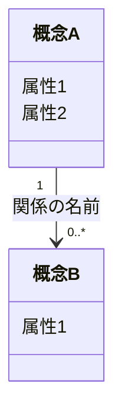

# オントロジー図

<!-- このページはテンプレートです。作る対象のシステムが扱う概念と、その関係を書きます。設計業務の 1 番目。 -->

## 概念と関係

## 用語

| 用語 | 意味 | 備考 |
| :--- | :--- | :--- |
| <概念A> | <このシステムでの意味を 1 行で> | <似た言葉との違いなど> |

## 対象外の概念

<このシステムでは扱わないと決めた概念と、その理由>
