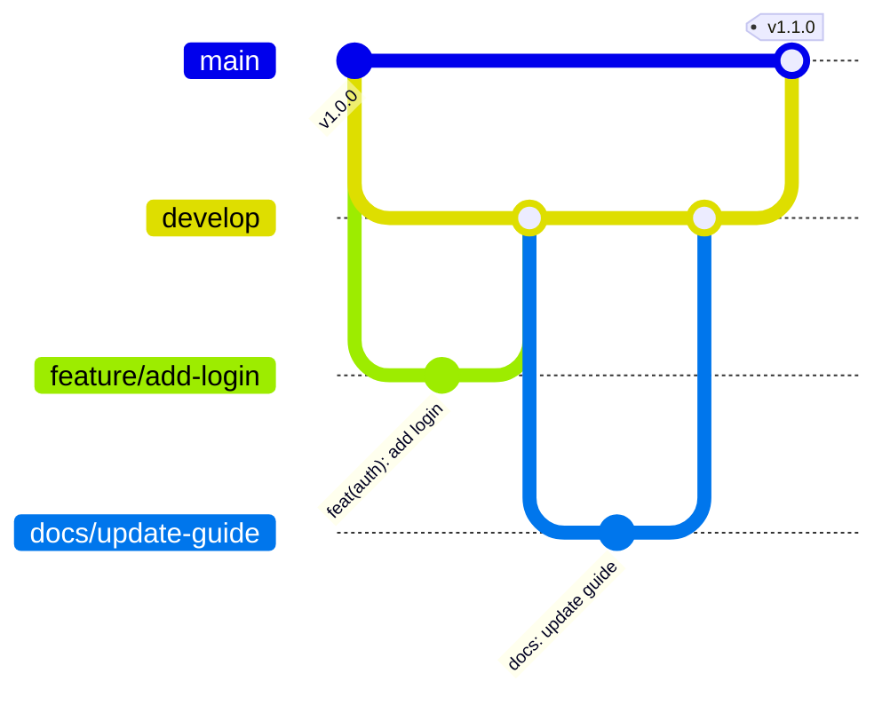
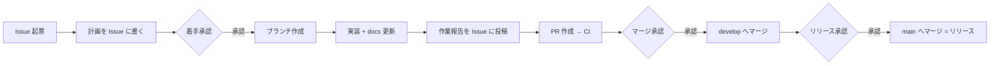

# 開発ガイド

このリポジトリの開発フローの正本。`README.md` / `AGENTS.md` / `CLAUDE.md` はこのページを要約・参照する。
ルールを変えるときは、このページを先に更新する（Docs as Code）。

## 基本方針

- **Issue 駆動**: 開発タスクの起票・相談・進捗・報告はすべて GitHub Issue で行う。
  1 Issue = 1 ブランチ = 1 PR を原則とする。
- **main ＝ リリース / develop ＝ ステージング**: 日々の変更は develop に集め、
  リリース時に develop から main へ反映する。どちらにも直接 push しない。
- **Docs as Code**: `src/` を変えた PR では `docs/` も更新する。
- **CI 必須**: PR は CI（GitHub Actions）が通らないとマージしない。

## ブランチ戦略

| Prefix | 用途 | SemVer影響 | 分岐元 | マージ先（PR の base） | 例 |
| :--- | :--- | :--- | :--- | :--- | :--- |
| `main` | メインブランチ（リリース） | なし | — | — | `main` |
| `develop` | ステージング | なし | `main` | `main` | `develop` |
| `feature/` | 新機能追加 | Minor | `develop` | `develop` | `feature/add-login-function` |
| `bugfix/` | バグ修正 | Patch | `develop` | `develop` | `bugfix/fix-crash-on-startup` |
| `hotfix/` | 緊急修正 | Patch | `main` | `main` → `develop` に戻す | `hotfix/fix-security-vulnerability` |
| `release/` | リリース準備 | Patch/Minor | `develop` | `main` → `develop` に戻す | `release/v1.2.0-prep` |
| `docs/` | ドキュメント更新のみ | Patch | `develop` | `develop` | `docs/update-api-docs` |
| `chore/` | その他メンテナンス | Patch | `develop` | `develop` | `chore/update-dependencies` |

`.github/workflows/check_branch.yml` が PR ごとに「ブランチ名の prefix」と「マージ先の組み合わせ」を検証する。

- `main` に向けてよいのは `develop` / `release/*` / `hotfix/*` だけ。
- `develop` に向けてよいのは `feature/*` / `bugfix/*` / `docs/*` / `chore/*` と、戻しの `release/*` / `hotfix/*`。



### リリース

1. develop がステージングとして確認済みであることを確かめる。
2. `develop` → `main` の PR（またはバージョン調整が要る場合は `release/*` → `main`）を作る。
3. main へのマージで `release-drafter` がリリースノートとタグを自動作成する。タグは手で作らない。
4. `release/*` / `hotfix/*` を使った場合は、同じブランチから `develop` への PR も作り、差分を戻す。

## コミットメッセージ

- 形式は `type(scope): subject`。例: `feat(api): add login`
- type は `feat` / `fix` / `docs` / `chore` / `refactor` / `test` / `ci`。scope は任意。
- 1 コミット 1 目的。CI（`ci.yml` の commit-lint）が PR 内の全コミットを検査する。
- **PR タイトルも同じ形式にする**（例: `ci: skip commit-lint on release PRs`）。
  マージは squash を基本とし、squash のコミット名は PR タイトルになる（リポジトリ設定で既定値を「PR タイトル」にする）。
  CI（`ci.yml` の pr-title-lint）が PR タイトルを検査する。
- `develop` → `main`（リリース）の PR では、develop で検査済みのため commit-lint と pr-title-lint を行わない。

## Issue 駆動の進め方



| 場面 | どこに書くか |
| :--- | :--- |
| 新しい作業・不具合・相談 | Issue を起票（テンプレートを使う） |
| 着手前の計画（変更ファイル・影響範囲・分割案） | Issue のコメント |
| 質疑・承認の記録 | Issue のコメント（「質疑記録」形式） |
| 作業報告 | Issue のコメント ＋ PR 本文 |
| 完了 | PR に `Closes #<番号>` を書き、マージで Issue を閉じる |

Issue の外（チャット・口頭）で決めたことも、決まったら Issue に「質疑記録」として残す。

## 承認・質疑（選択肢方式）

承認や仕様の確認は、自由記述ではなく **選択肢方式** で問い合わせる。
Claude Code では `AskUserQuestion` ツールを使い、回答者は選択肢を選んで **Submit Answer** を押す。

### 問い合わせのルール

- 1 回の問い合わせは 1〜4 問、各問 2〜4 択。
- 推奨案がある場合は先頭に置き、ラベル末尾に「（推奨）」を付ける。
- 各選択肢の説明に「選んだ場合に何が起きるか」を書く。
- 選択肢で表せない回答（Other の自由記述）が来た場合は、内容を要約して、もう一度選択肢で確認する。
- 回答が来るまで、承認が必要な操作（マージ・リリース・方針変更）は実行しない。
- 回答を受けたら、Issue に次の形式で記録する。

```markdown
### 質疑記録
- 問い: <質問文>
- 選択肢: A（推奨）/ B / C
- 回答: B
- 次の行動: <回答を受けて何をするか>
```

### 承認ゲート

| ゲート | タイミング | 選択肢の例 |
| :--- | :--- | :--- |
| G1 着手承認 | 計画を Issue に書いた後 | 承認して着手（推奨）/ 計画を修正 / 中止 |
| G2 マージ承認 | PR 作成・CI 通過・作業報告の後 | develop にマージ（推奨）/ 修正してから再確認 / 保留 |
| G3 リリース承認 | develop の確認後 | main にリリース（推奨）/ 延期 / 一部だけ release/ で出す |

小さな仕様の迷い（命名・配置・実装方式）も、推測で決めずに選択肢で確認する。

## 作業報告

作業の区切り（計画完了・実装完了・PR 作成・マージ後）ごとに、次の形式で Issue にコメントする。
PR 作成時は同じ内容を PR 本文の「作業報告」に入れる。

```markdown
## 作業報告（<フェーズ名>）
- 対象 Issue: #<番号> / ブランチ: <branch> / PR: #<番号>
- 変更したファイル:
  - <path>: <何を変えたか>
- 実行したコマンドと結果:
  - `mkdocs build --strict`: 成功 / 失敗（内容）
- 確認できていないこと:
  - <未実行のテスト、推測で書いた箇所、TODO>
- 次のアクション: <承認待ち（G2）など>
```

報告を投稿したら、続けて承認ゲートの問い合わせ（選択肢方式）を行う。

## CI

| ワークフロー | タイミング | 内容 |
| :--- | :--- | :--- |
| `ci.yml` | PR（main / develop 向け）、develop への push | `mkdocs build --strict`、コミットメッセージ・PR タイトル検査（develop → main の PR は対象外）、Docs as Code 検査 |
| `check_branch.yml` | PR | ブランチ名 prefix とマージ先の組み合わせ検査 |
| `pr-labeler.yml` | PR | ブランチ名・変更ファイルからラベル付与 |
| `release-drafter.yml` | main への push | リリースノート・タグの自動作成 |

Docs as Code 検査は、`src/` に変更があるのに `docs/` に変更がない PR を失敗させる。
ドキュメント更新が本当に不要な場合だけ、PR に `skip-docs` ラベルを付けて理由を PR 本文に書く。
